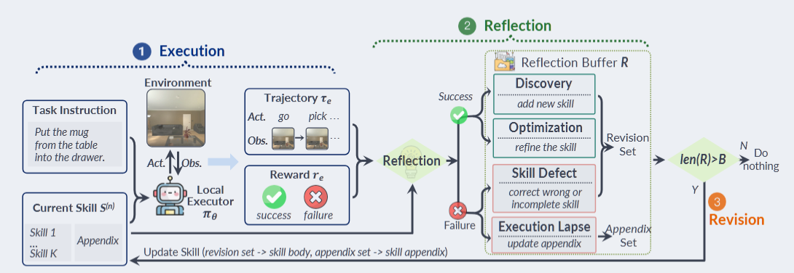
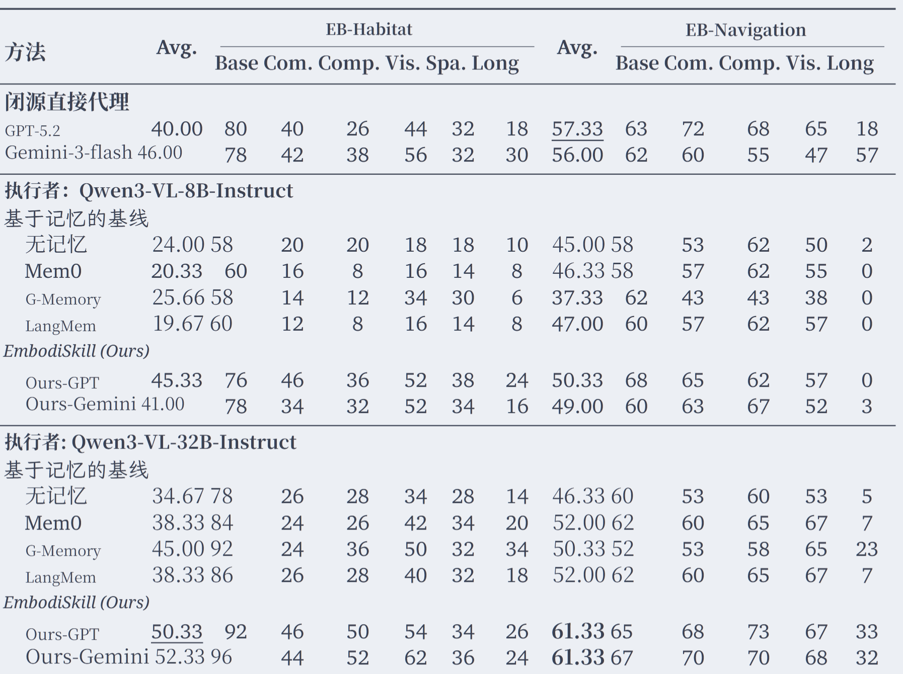
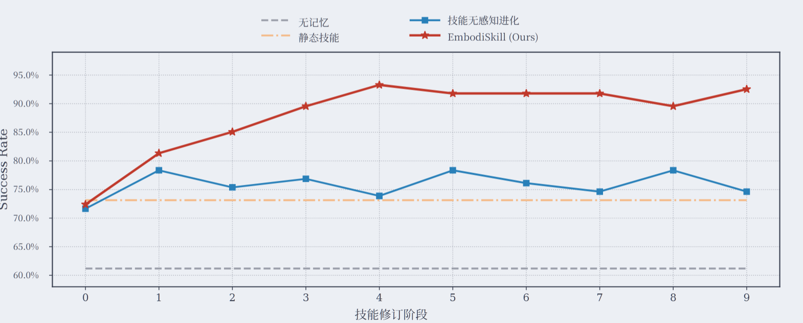
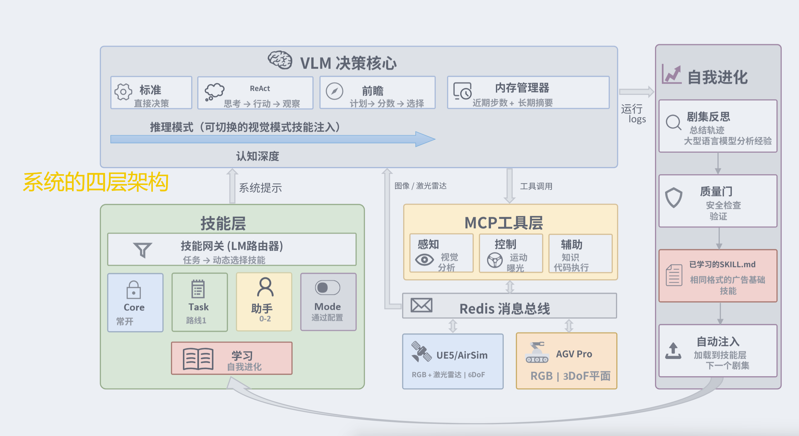
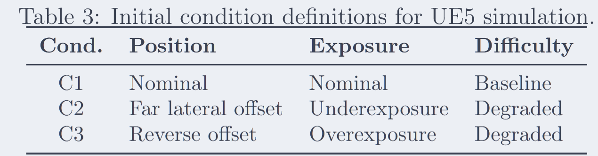
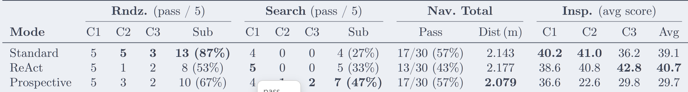
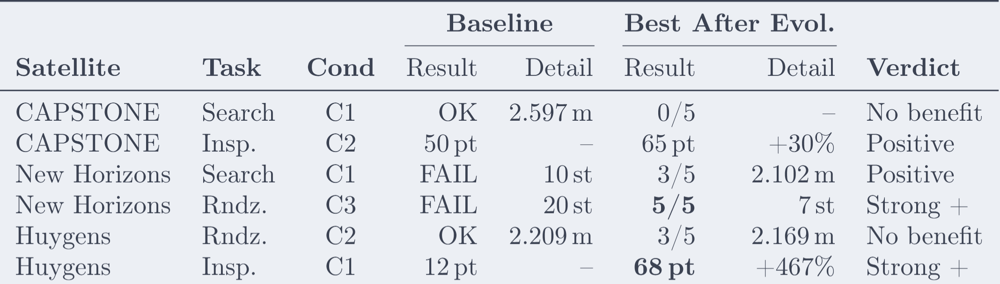
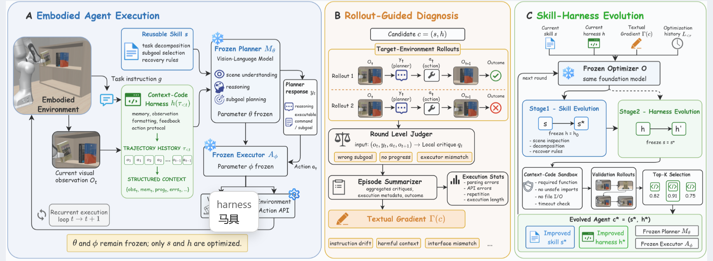

# 有关于具身智能体自进化文献三则

## 一、EmbodiSkill: Skill-Aware Reflection for Self-Evolving Embodied Agents

#### **作者**：Ruofei Ju, Xinrui Wang, Xin Ding 等

#### **机构**：Nanjing University ，Huazhong University of Science and Technology ，University of Science and Technology of China ，Microsoft Research ，Institute for AI Industry Research (AIR), Tsinghua University

**2026年7月14日**

#### Keywords：**Embodied Agents，Skill Self-Evolution，Skill-Aware Reflection，Training-free Framework**，**Targeted Revision**

##### 阅读时间：2026.10.2

#### 第一章：背景介绍

具身智能体面对环境突然改变的可能需要实现自我进化，但是现在的这项任务主要是在数字环境中实现，并且只是粗略的技能更新。如果用这种去应用真实环境，可能存在问题，因为任务执行失败的因素可能是技能错误或者执行错误多种因素，而不是简单的重新去技能更新解决。

所以，核心挑战不仅在于具身智能体如何使用技能,还在于技能如何从轨迹中自我进化为更完整、准确和可执行的形式。

文献中提出了EmbodiSkill，一个通过技能感知反思和针对性修订进行具身技能自我进化的无训练框架。

现有方案的缺陷：

当任务失败后，总结轨迹的时候，将任务失败的因素归结于技能的缺陷，从而前去更新技能，但是它并不知道技能错误的根源，所以全部更新，这会造成数据冗余，并且可能正确的技能被改错。

**最主要需要让它认识到，任务的失败并不等于是内容技能的错误。**

EmbodiSkill解决方案是不会将轨迹转换为用于重写整个技能的通用反馈，而是技能感知反思利用轨迹来检查当前技能,并确定应添加、优化、纠正或保留哪些技能内容。

1、一个轨迹在揭示缺失技能内容时会导致发现——提出的是新技能内容

2、在建议执行现有技能的更好方式时会导致优化——修订版本或修改指令

3、在暴露不正确、不完整或未充分定义的技能内容时会导致技能缺陷——提供缺陷的轨迹证据,并提出修正后的技能内容

4、在技能有效但智能体未能执行时会导致执行失误——生成附录内容提示

#### 第二章：相关工作

##### 2.1具身智能体的基于记忆方法

智能体在任务执行过程中经常面临重复出现的物体、空间布局、动作约束。利用这种重复的常见方法之一是适应**基于记忆**的智能体方法,这些方法存储过去的轨迹、摘要或结构化笔记,并检索相关记忆来指导后续的决策.**这些方法主要是重用，而不是技能指导**

##### 2.2技能和智能体的技能自我进化

最开始的智能体只会利用工具，无法去修改技能内容

随后在虚拟世界能够修改

但是现实物理环境对其造成困境，于是EmbodiSkill 出现。**每个轨迹用于生成目标修正信号,并通过技能感知进化螺旋整合合理的修订,而不是整体重写技能。**

#### 第三章：方法

**3.1问题公式化：**

**3.2. EmbodiSkill**

执行者按当前技能做任务——看轨迹，写反思——积累一批反思，再统一整合——改正文，还是加附录——身体级别更新反思\执行失误的反思

技能感知反思与轨迹总结不同。它不会将一个轨迹转换为用于重写整个技能的一般反馈，而是确定轨迹是否支持添加新的技能内容、优化或纠正现有的技能内容,或更新技能附录

#### 第四章：实验

##### 4.1设置

三个具身任务基准测试：ALFWorld , EmbodiedBench‐Habitat,和 EmbodiedBench‐Navigation。涉及导航，开容器，改变状态；3d环境视觉物体交互；视觉导航

每个轨迹的最大反思次数为 K = 1，执行 10 个技能修订阶段，测试评估期间，进化后的技能是固定的

**4.2结果**

这些结果表明,将训练轨迹整合到一个进化的技能中,比直接使用前沿模型执行或检索轨迹级记忆提供了更强的指导。

EmbodiSkill从静态技能快速提升,并保持高成功率, 而技能无感知进化收敛到较低性能范围。

#### 第五章：结论

文献主要是解决智能体在物理环境中需要进行的自进化困境，需要让其在执行任务过程之中能够从轨迹提取到有效经验，不断修正和更新自身技能。所以提出框架 **EmbodiSkill** ，无需训练，利用大模型对于执行轨迹进行结构化复盘，将结果分为四类，任务成功的发现和优化，任务失败的技能缺陷和执行失误。主要是避免全局重写技能。

创新点为

具身技能自进化变成技能感知反思 + 选择性修订。用四种反思区分技能该改和执行没做好，把技能分成主体和附录；只有真正指向技能缺陷的证据才改正文，执行失误只写进附录。这样技能不会被失败轨迹带偏，能在冻结模型的前提下，通过执行—反思—修订—再执行的螺旋持续进化，最终大幅提升具身任务成功率。

## 二、SpaceMind: A Modular and Self-Evolving Embodied Vision-Language Agent Framework for Autonomous On-orbit Servicing

**作者**：Aodi Wu, Haodong Han, Xubo Luo, Ruisuo Wang, Shan He, Xue Wan

**单位**：中国科学院大学；中国科学院空间应用工程与技术中心

**代码**：https://github.com/wuadi/SpaceMind

阅读时间：2026.10.6

### 第一章：背景介绍

#### 1、问题挑战

近地轨道空间碎片的日益增多和卫星的老化，在轨服务、组装和制造已成为一项日益关键的能力。

NASA的OSAM‐2、欧洲航天局的ClearSpace‐1, 以及RemoveDEBRIS等任务已展示了**主动碎片清除和卫星寿命延长**的早期概念

当前的操作方法依赖于为已知合作目标设计的预编程序列,**限制了它们处理真实在轨遭遇中多样化和不可预测条件的能力**

就是说将**vlm大模型运用到航天**之中，通过对于获取视觉信息的输入去推理执行相关的任务，比如说是对轨

#### 2、四个挑战以及解决方式：

1、没有模块化智能体架构——知识拆成独立**技能模块**，；LLM 做**动态路由**，根据当前任务选择该用哪个技能；**Redis 消息总线**把智能体和物理后端解耦，所以同一套代码能在模拟和真实硬件上跑

2、没有灵活的切换推理深度机制——

**标准模式**：直接决策；

**ReAct 模式**：思考—行动—观察循环；

**前瞻模式**：预测多个候选，再选最好的。

**分层记忆系统**：短期：记住最近几步的细节；长期：保存压缩后的摘要。

3、不会从经验中改进，每次任务都从零开始——对于重复场景，智能体反思操作经验提炼成**结构化学习技能文件**

4、设计决策缺乏系统验证——做了大规模闭环实验，5 颗卫星；3 种推理模式；3 种初始条件；2 种环境：高保真 UE5 模拟 + 物理实验室；

### 第二章 ：相关工作

#### 1、传统缺陷

自主在轨服务传统上依赖于针对已知合作目标的**预编程序列**,感知由**专用管道**处理航天器检测 

 近期的研究探索大语言以及视觉语言模型作为操作员的途径，Rodriguez-Fernandez 等人用自然语言模型做任务分解，Carrasco 等人扩展到视觉语言模型用于决策。

三个关键局限性

1、单体提示和没有模块化框架，无法实现多任务可扩展性

2、读取屏幕文本和用户界面元素，而不是处理实际视觉传感器数据

3、报告了少量运行结果,且没有进行跨环境验证

**2.3经验驱动与自我改进**

让智能体从部署经验中自主改进，是具身空间智能体的长期目标。但现有适应范式在太空操作场景中均存在显著局限，比如智能体反思保留在上下文窗口会丢失，轨迹提取经验缺乏结构化模式，建立持久数据库却运行在数字沙盒。

SpaceMind 的技能自进化机制旨在填补这一空白。

### 第三章：方法论

**3.1系统概述**

paceMind 是一个闭环具身智能体框架,其中视觉语言模型作为中央决策控制中心。

每个决策步骤 t,智能体从环境中接收一个观察 ——组合动态路由的技能模块、推理模式指令和分层记忆上下文来组装系统提示——生成动作——Redis 消息总线转发

**3.2技能层以及动态路由**

现有方法基于vlm随着更多任务的添加,提示变得难以管理,共享策略无法跨任务重用,并且在操作期间积累的经验没有结构化的容器进行存储。

解耦，任务技能与推理能够自由组合

**3.2三种推理模式各自使用场景**

标准模式： VLM接收当前观察结果、系统提示以及可用工具列表,直接生成一个工具调用作为其动作

ReAct模式：智能体生成一个显式的推理轨迹,然后选择并执行一个工具,观察结果后再决定是继续推理还是提交运动动作

前瞻模式：智能体针对高不确定性场景采用两阶段深思熟虑过程。规划阶段,VLM生成三个候选动作,每个动作均附带预测结果和风险评估。 在选择阶段,第二次VLM调用评估候选动作并选择具有最有利预测结果的那一个

所有三种模式都仅通过模式技能注入来激活,并且与任务特定技能完全解耦

**3.4接口与通信架构**

要求：在模拟里，它要调用 AirSim 的接口拿图像、发命令。
            在真机里，它要调用 ROS2 的接口拿图像、发命令。

主要还是解耦，一个代理‐工具协议和一个工具‐环境通信总线

第一层：MCP工具协议：把所有功能包装成统一格式的“工具”，智能体只按名字和参数调用，不关心工具内部怎么实现。

第二层：Redis 消息总线：在工具与硬件间传话

| 智能体怎么统一调用各种功能？   | MCP 工具协议   |
| ------------------------------ | -------------- |
| 工具怎么统一连接不同硬件后端？ | Redis 消息总线 |

#### 3.5自进化机制

相同的任务类型在不同目标和条件下会重复出现，这就能运用自身进化去完成的机会。

传统方法：模型微调需要标记训练数据和梯度计算,强化学习要求显式奖励函数设 计,情境学习受上下文窗口限制且不会跨会话持久化,而检索增强生成只能检索现有文档而非合成新知识。

spacemind主要是运用技能自进化机制，让智能体在场景中自主生成、验证、积累经验。

标准决策循环的外部循环运行

主要流程：场景总结——**经验反思**——质量门——学习技能生成——自动注入

设计具有四个特性：

1、学习技能与模块化技能架构天然兼容

2、知识是持久且可审计

3、进化是渐进的

4、质量门提供安全保证

### 第四章：实验

虚幻引擎5(UE5)模拟和物理实验室环境；192次闭环运行；五个卫星、三个任务和三个初始条件下系统地比较了推理模式

任务：会合，搜索与接近，检查

三种初始条件来评估鲁棒性：

所有实验均使用开源的Qwen3‐VL‐235B‐A22B模型作为VLM决策核心

实验结果

**没有单一的推理模式占主导**

![image-20261003123817104](image-20261003123817104-1791002298216-11.png

**技能自进化**

自进化活动评估技能自进化机制是否可以通过重复执行积累有用的操作知识

在所有组别中,标准技能文件格式中生成了七个学习技能,并在后续轮次中由技能网关正确路由,这证实了自我进化机制与模块化架构之间的兼容性。

**现实世界验证**

智能体循环、MCP 工具签名和 Redis 通信合约，两个卫星模拟器、三个任务和每个组合三次重复的情况下,总计 18 次运行

| Satellite | Rndz. Pass | Rndz. Runs | Rndz. Rate | Search Pass | Search Runs | Search Rate | Insp. Avg Score | Insp. Runs |
| :-------- | :--------- | :--------- | :--------- | :---------- | :---------- | :---------- | :-------------- | :--------- |
| CAPSTONE  | 3          | 3          | 100%       | 2           | 3           | 67%         | 41.0            | 3          |
| Artemis   | 3          | 3          | 100%       | 2           | 3           | 67%         | 34.0            | 3          |
| **Total** | **6**      | **6**      | **100%**   | **4**       | **6**       | **67%**     | **36.8**        | **6**      |

验证了接口和通信架构,并证明了 SpaceMind 的模块化设计能够泛化到不同环境。

#### 第五章：结论

spacemind创新性在于它设计了太空操作模块化，自我进化的具身智能体，可调整的推理深度。自我进化机制在错误纠正方面表现出色，对于成功的行为增幅较小。说明其主要适用于作为自动故障恢复系统。

局限性：VLM 的 3D 空间理解有限，退化条件下仍会误判空间关系；任务成功的自我进化机制价值小，技能和自进化只能部分弥补。

## 三、Self-Evolving Embodied Agents via Skill-Harness  Evolution

**作者**：Peidong Wang, Zhiming Ma, Ying Chang, Xufang Luo, Yiqun Zhang, Zihan Wang, Xiaocui Yang, Shi Feng, Yuqing Yang, Dongsheng Li

**机构**：Northeastern University；Microsoft Research

**核心关键词**：无训练具身自适应、技能进化、上下文代码 harness、冻结模型、文本梯度、固定动作接口

阅读时间：2026.10.9

## 第一章：背景

具身智能体越来越庞大，出现的数据冗余

提出shaper框架，主要是无训练，自适应，自进化

智能体任务主要流程：任务 → 上下文构建 → 大模型推理 → 输出解析 → 动作接口 → 执行包装器 → 可重用技能 → 环境

## 第二章：相关工作

传统方法：

1、具身基础模型 + 参数更新适应

视觉-语言-动作模型：看图像；理解指令；输出机器人动作

适应新环境：监督微调 SFT：拿示范数据继续训练；强化学习 RL：设计奖励函数，继续训练；

局限：需要能拿到模型权重；有任务示范或奖励；额外训练。

如果模型权重不可更改，或者说是训练贵，我们不要去修改模型权重，只改变它的外部组件，实现自进化智能体。

具身智能体的无训练适应

把冻结模型和别的东西组合起来。**可执行机器人 API**，**可重用技能**

局限：可编程接口；感知模块；执行监控器。

总结：

其他方法要么改模型参数，要么改外部技能或代码，但都有局限——要数据、要 API、只改一样、或只在文本环境有效。SHAPER 的定位是：冻结所有模型参数，同时进化可重用技能和上下文构建代码 harness，针对固定动作接口，用 rollout 反馈来优化，不依赖机器人 API。

- 模型权重不变；
- 执行器不变；
- 只改 skill 和 harness。

## 第三章：方法

**3.1无训练代理分解**

具身智能体分解为四个系统组件:一个VLM规划器 Mθ、一个执行器 Aφ、一个可重用技能 s和一个上下文代码 harness h

执行器可能是一个VLA actor或一个环境动作API的包装器。技能是规划器提示中 的文本程序指导,涵盖场景检查、任务分解、子目标选择、恢复和终止。harness是一个上下文 构建器——实现为一个Python函数

shaper主要是冻结了模型本身的参数规划器以及执行器，而是将进化的方向转向为外部组件，可重用技能和上下文代码，利用外部的信息更迭，而不是模型本身的权重训练，这样就可以减少模型进化的负担。可重用技能主要是解决重复性任务，然后能通过轨迹去进化它的技能，其次，上下文代码能够决定规划器每次看到什么观察、先行动作、执行结果、反馈，以及怎么组织这些信息。

**3.2 基于试跑轨迹引导的文本诊断**

SHAPER 不直接把完整视觉轨迹交给优化器，而是分**三层诊断**。

第一层，对每个规划轮次比较执行前后观察，输出局部评论，识别错误子目标、缺乏进展、执行器不匹配。它去看执行前观察，执行器输出，执行器动作，执行后观察，对于每一步的评估。

第二层，剧情总结器结合非视觉元数据、终端 harness 上下文、轮级评论和最终奖励，其次就是最后汇总每一次的小总结，然后给出文字输出。

第三层，批次聚合把所有单集总结和统计拼接成文本梯度，观察无益重复、指令漂移、缺失进度跟踪、有害上下文、解析/API 错误，供优化器改 skill 和 harness。

**3.3 两阶段技能‐ harness 进化**

模型 = 主要是完成推理，指导任务

技能 = 不同的任务能有不同的技能去完成

上下文构建代码 = 主要简化数据

执行器 = 比如机械臂具身完成任务

上下文构建代码，就是每次模型做决定前，自动帮它整理“前情提要”和“重点截图”的程序。

skill就是技能，主要是告诉规划器如何去执行任务，如何分解，失败后恢复，停止等信息供给。

harness就是上下文代码。主要是决定规划器能够看见什么轨迹

同一个冻结 VLM：

当 planner 时，负责行动；

当 optimizer 时，负责改 skill 和 harness。

同一个模型，能够开始当做执行器去完成，然后传回轨迹信息，又能够变成优化器去识别这些信息去优化技能以及上下文代码。

**两阶段进化**

开始是初始方案，s和h，然后shaper会保留多个组合，技能➕harness去拿去打分。

固定初始 harness ，只改技能

再固定选定的技能 skill，再改 harness

通过优化器选择到最好的组合

## 第四章：实验

#### 1、VLABench环境

**语言条件机器人操作基准**主要是对于自然语言的理解与任务推理

- 所有代理系统都用 **Qwen3.6-27B** 作为冻结的上级规划器。
- VLABench 上，执行器是官方 **π0 检查点**，在十个原语任务类别上微调，通过 **OpenPI** 提供。
- π0 接收文本子目标，产生 **5 动作块**的低级控制。
- 上级规划器为每个子目标指定环境步预算，一个规划轮次可以执行多个块。
- 一个 episode 最多允许 **10 个规划轮次**和 **400 个低级环境步**。
- ESI-Bench 上，同一个规划器通过固定交互 API 执行，最多 30 步。

| 划分 | 目标类别 | 任务表单       | 难度含义                         |
| :--- | :------- | :------------- | :------------------------------- |
| C1   | Seen     | 语义理解       | 完全在领域内，最简单             |
| C2   | 未见     | 语义理解       | 目标没见过，但任务类型一样       |
| C3   | Seen     | 常识与世界知识 | 目标见过，但任务形式变了         |
| C4   | 未见     | 常识与世界知识 | 目标没见过，任务形式也变了，最难 |

| 方法                 | C1       | C2       | C3       | C4       | 总体      |
| :------------------- | :------- | :------- | :------- | :------- | :-------- |
| 直接 VLA             | 26.0     | 9.5      | 45.0     | 12.5     | 23.25     |
| SFT（相同数据）      | 32.5     | 13.0     | 38.0     | 12.5     | 24.00     |
| VLA + MG-Select      | 25.0     | 12.0     | 29.5     | 19.0     | 21.38     |
| VLA + VOTE           | 26.0     | 12.5     | 33.0     | 16.5     | 22.00     |
| 种子代理 + MG-Select | 35.0     | 15.0     | 40.5     | 7.0      | 24.38     |
| 种子代理 + VOTE      | 38.0     | 13.0     | 34.0     | 9.0      | 23.50     |
| 种子代理             | 40.0     | 20.0     | 40.0     | 13.0     | 28.25     |
| 技能进化             | 42.0     | 23.5     | 50.0     | 18.5     | 33.50     |
| harness 进化         | 42.0     | 21.0     | 46.0     | 13.0     | 30.50     |
| **SHAPER**           | **42.5** | **26.0** | **50.0** | **19.5** | **34.50** |

冻结模型不变，只进化 skill 和 harness，就能把总体成功率从 28.25 提到 34.50，超过 SFT 和测试时缩放；其中技能进化贡献最大，harness 是补充，完整 SHAPER 最好。

#### 2、ESI‐Bench

**具身空间智能基准。**主要是**主动感知、移动、操作**，去获取初始视图里没有的证据

| 类别         | n            | 种子代理 | 进化技能 | SHAPER   | GPT-5 PS† |
| :----------- | :----------- | :------- | :------- | :------- | :-------- |
| 物理结构     | 21           | 14.3     | 38.1     | 38.1     | 51.4      |
| 物理动力学   | 10           | 40.0     | 40.0     | 40.0     | 46.1      |
| 镜面反射     | 20           | 10.0     | 20.0     | 60.0     | 53.0      |
| 感知基础     | 49           | 53.1     | 59.2     | 69.4     | 24.9      |
| 度量比较     | 21           | 33.3     | 47.6     | 47.6     | 48.2      |
| 枚举感知     | 18           | 16.7     | 33.3     | 27.8     | 10.7      |
| 空间关系     | 51           | 27.5     | 37.3     | 54.9     | 31.0      |
| 认知地图     | 17           | 29.4     | 23.5     | 23.5     | 60.4      |
| 时间理解     | 19           | 47.4     | 47.4     | 47.4     | 40.6      |
| 动作序列     | 5            | 40.0     | 40.0     | 20.0     | 36.4      |
| **微观平均** | **231**      | **32.5** | **41.1** | **49.8** | —         |
| **宏观平均** | **10个类别** | **31.2** | **38.6** | **42.9** | **40.3**  |

微观平均=所有类别的题目总数\所有类别中答对的题目总数

宏观平均=(1准确率+类别2准确率+⋯+类别n准确率)\n

ESI-Bench 上，完整 SHAPER 微观上达到 49.8% ，宏观42.9%，技能进化在 10 个类别中改进了 6 个：物理结构；镜面反射；感知基础；度量比较；枚举感知；空间关系。再加上 harness 进化后，提升最明显的是：镜面反射；感知基础；空间关系

## 第五章：结论

SHAPER 证明：不更新模型参数，只进化外部技能和上下文构建代码，也能让冻结的具身智能体在固定或受限动作接口下持续提升任务成功率。它在 VLABench 和 ESI-Bench 上都优于种子、同数据 SFT 和测试时采样方法；技能进化贡献最大，harness 进化有补充作用。该方法轻量、可复用、成本可控，适合模型训练昂贵、不可用或不需要训练的场景。

## 创新点

1. 把无训练具身自适应形式化为非参数优化，优化对象是模型外部技能和上下文 harness；
2. 同时进化 skill 和 context-code harness，而非只进化技能或只合成 harness；
3. 同一个冻结 VLM 既当 planner 又当 optimizer，只换 prompt；
4. 用三层诊断生成紧凑文本梯度；

### 三则文献的总结

- **EmbodiSkill**：技能感知反思，区分“技能缺陷”和“执行失误”。
- **SHAPER**：同时进化技能和上下文代码 harness。
- **SpaceMind**：面向太空在轨服务的模块化、自进化 VLM 智能体框架。

三篇都遵循一个闭环：

> **执行 → 轨迹 → 反思/诊断 → 进化外部知识 → 注入下一轮 → 再执行**
>
> 三则文献定位

| 维度            | EmbodiSkill                        | SHAPER                         | SpaceMind                               |
| :-------------- | :--------------------------------- | :----------------------------- | :-------------------------------------- |
| **领域**        | 通用具身：家庭任务、视觉交互、导航 | 固定接口具身操作与导航         | 太空在轨服务                            |
| **进化对象**    | 技能主体 + 技能附录                | 技能 + 上下文代码 harness      | 技能模块 + 学习技能文件 + 工具/推理配置 |
| **核心机制**    | 技能感知反思，四类反思             | 文本梯度，两阶段 skill→harness | 技能自进化 + 质量门 + 模块化路由        |
| **记忆/上下文** | 技能附录强调有效内容               | harness 控制 planner 看到什么  | 分层记忆 + MCP + Redis                  |

**EmbodiSkill**:

只改自然语言写的**技能文本**。但它做了一个极其巧妙的切分：把技能分为**“主体（正文）”**和**“附录”**

**SpaceMind:**

进化的不仅是**文本技能**，还有**系统配置**比如技能模块、工具白名单、推理模式。它更偏加完整。

**SHAPER:**

不仅要改自然语言写的**“技能文本（Skill）”**，还要改**“上下文构建代码**

在模型参数冻结、机器人 API 可能不可用、真实部署数据稀缺的条件下，具身智能体仍然可以通过“执行—反思—进化—注入”的闭环，从自身轨迹中积累结构化、可审计、可复用的程序性知识。
**技能进化是核心，上下文/harness 是补充，质量门是安全保障，模块化是跨环境迁移的基础。**

三则文献主要都是对于智能体的自我进化方面，

文献embodiskill提出了轨迹的技能文本的进化，区分了轨迹反馈中失败的两类情况做出不同的处理方式，改变了原先需要重写技能导致的数据冗余以及复杂。

文献spacemind提出的自进化包括了技能文本以及系统配置，总线实现对于真实物理环境与数字环境的统一接口，三种推理模式面对不同任务的选择，将各功能模块化只取用而无需明白具体的内容，可以自由选择。

文献shaper主要是当模型大脑冻结时，免去了训练权重的过程，出于训练费用或者是训练难度考虑，从而是对于外部组件的自进化的研究，使仅使用外部组件以及上下文构建代码就可以实现对于任务的完成度提高，自进化。

