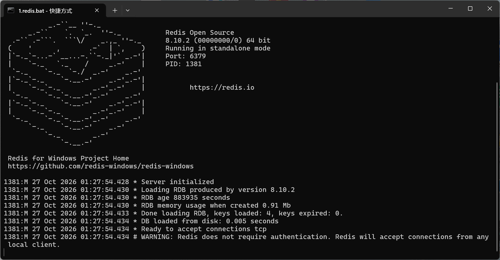
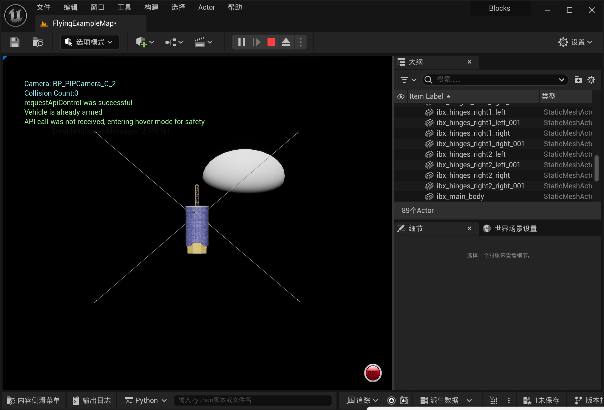
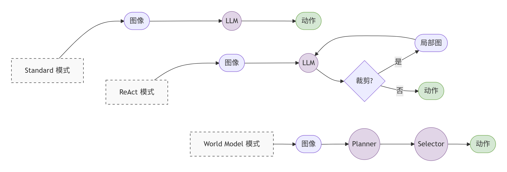

三文献中的保护措施

#### EmbodiSkill 技能自我反思

**正文与附录分离**：
最核心的保护机制。针对“执行失误”，系统绝对不修改技能正文，而是生成一段“重点警告”放入技能附录。这防止了核心规则被稀释或污染，实现了“逻辑泛化”与“行为纠偏”的物理隔离。

**反思缓冲与冲突消解**：
系统不会一遇到失败就立刻改技能。而是积累一定数量的反思记录后，统一进行**去重、合并冲突**。如果大模型的修改建议存在矛盾或位置放错，系统会直接将其丢弃，绝不强行写入。

**受限编辑器模式**：
在最终修改技能时，系统会严格限制大模型的行为。大模型不能全局重写技能，针对被反思锁定的特定内容进行修改，未被涉及的内容保持原样。

#### SpaceMind:一个模块化和自进化的具身视觉语言智能体框架,用于自主在轨服务

文本

质量门：

安全短语黑名单：

系统维护一个危险词汇表，主要优化大模型生成的覆盖指令，当指令与危险词汇表匹配，便拒接此技能。专注于飞行间碰撞，限速等问题。
去重：

大模型总结失败经验时，可能会生成多次相似的技能，导致数据冗余。所以系统会对生成的技能文本计算文本向量相似度，如果高度重复，拒绝写入
任务范围绑定：

不同任务中学会的经验往往不适于通用，所以生成的每一个技能都有任务域标签，等需要技能网关只会加载匹配技能

#### shaper  上下文代码自进化

文本 + **Python 代码**

所用沙盒验证，允许大模型直接生成和修改python代码，开放但危险，所以需要验证。
四重审查：
接口签名强制匹配，生成的代码要是规定好的函数名
环境隔离，禁止import，打开读取文件，网络请求等危险操作
超时熔断：限制代码的生成时间，减少因为死循环超时
错误回传：代码在沙盒报错，不会被丢弃，捕获日志当做负面反馈回传修正。

三层蒸馏：
轮次级判断，每一轮总结
单集总结，宏观轨迹复盘
批次聚合，所有单集聚合，统计跨场景共性问题

实验配置：

所用模型：qwen2.5-vl-7b---Qwen3-VL-235B-A22B（论文）

Redis 作为通信总线

 UE5/虚幻引擎会把拍到的**画面和雷达数据**发到 Redis 里。

 host.py会从 Redis 里**读取**这些数据，然后把算出来的**飞行动作指令**发回 Redis，UE5 再去执行。

环境：ue5    3D 实时渲染和物理仿真引擎

图片：448

大模型输出限制是1024 个 Token

ue5初始条件定义

c1：标称   标称

   "C1": {
        "label": "normal",
        "rendezvous-hold-front":   {"x": -11, "y": 0, "z": 0, "yaw": 0},
        "search-then-approach":    {"x": -11, "y": 0, "z": 0, "yaw": 0.5},
        "inspection-diagnosis":    {"x": -5,  "y": 0, "z": 0, "yaw": 0, "exposure": 0},

c2：远测漂移    曝光不足

  "C2": {
        "label": "far_offset",
        "rendezvous-hold-front":   {"x": -15, "y": 2, "z": -1, "yaw": 0},
        "search-then-approach":    {"x": -15, "y": 2, "z": -1, "yaw": 0.8},
        "inspection-diagnosis":    {"x": -7,  "y": 2, "z": -1, "yaw": 0, "exposure": -2},

c3：反向漂移    曝光过度

  "C3": {
        "label": "offset_alt",
        "rendezvous-hold-front":   {"x": -11, "y": -2, "z": 1, "yaw": 0},
        "search-then-approach":    {"x": -11, "y": -2, "z": 1, "yaw": -0.5},
        "inspection-diagnosis":    {"x": -5,  "y": -1, "z": 1, "yaw": 0, "exposure": 2},

原实验5轮次，本实验3轮次，安全阈值为2m

三种推理模式

### 实验a 消融实验

| 序号 | 任务       | Profile              | 结果             | 最终距离/得分 | 论文表 4 |
| :--- | :--------- | :------------------- | :--------------- | :------------ | :------- |
| 1/9  | rendezvous | vision_only          | **FAIL**         | 165.00 m      | FAIL     |
| 2/9  | rendezvous | hybrid_nav           | SUCCESS          | 1.98 m        | SUCCESS  |
| 3/9  | rendezvous | hybrid_nav_with_code | SUCCESS          | 1.98 m        | SUCCESS  |
| 4/9  | search     | vision_only          | **FAIL**         | 11.50 m       | FAIL     |
| 5/9  | search     | hybrid_nav           | SUCCESS          | 1.98 m        | SUCCESS  |
| 6/9  | search     | hybrid_nav_with_code | SUCCESS          | 1.98 m        | SUCCESS  |
| 7/9  | inspection | vision_only          | SUCCESS（score） | **70.00**     | 65       |
| 8/9  | inspection | hybrid_nav           | SUCCESS（score） | **85.00**     | 最高     |
| 9/9  | inspection | hybrid_nav_with_code | SUCCESS（score） | **20.00**     | 50       |

复现原实验结论，

在标准c1环境下，当只用视觉时，三类卫星任务全然失败；

用雷达，以及雷达＋视觉的组合，任务成功

模型评估器对于打分偏高

### 实验b：三种环境✖三种推理模式✖三个卫星任务✖重复三组

### rendezvous-hold-front

#### c1条件

| 模式            | 轮次     | 结果     | 最终距离         | 步数         |
| :-------------- | :------- | :------- | :--------------- | :----------- |
| Standard 5/5    | r1/r2/r3 | 3/3 成功 | 全部 **1.902 m** | 21 / 19 / 18 |
| ReAct 5/5       | r1/r2/r3 | 3/3 成功 | 全部 **1.200 m** | 12 / 12 / 18 |
| World_model 5/5 | r1/r2/r3 | 3/3 成功 | 全部 **1.902 m** | 21 / 18 / 16 |

**C1 Rndz 成功率完全一致**；

#### c2条件

| 模式            | 轮次 | 结果 | 最终表现 / 距离      | 步数 | 失败原因         |
| :-------------- | :--- | :--- | :------------------- | :--- | :--------------- |
| Standard  5/5   | r1   | 成功 | 停稳                 | 17   | 完美执行         |
|                 | r2   | 成功 | 停稳                 | 18   | 完美执行         |
|                 | r3   | 成功 | 停稳                 | 17   | 完美执行         |
| ReAct 1/5       | r1   | 失败 | **2.2 m**            | 7    | 提前终止         |
|                 | r2   | 失败 | 越飞越远             | 超时 | **方向判断失败** |
|                 | r3   | 失败 | 无法收敛             | 超时 | 长时间振荡，超时 |
| World_model 3/5 | r1   | 失败 | **9.8 m**            | 5    | 提前终止         |
|                 | r2   | 失败 | **12 m**             | 4    | 提前终止         |
|                 | r3   | 失败 | **2.9m - 3.5m 徘徊** | 超时 | 长时间振荡，超时 |

#### c3条件

| 推理模式         | C1          | C2          | C3          |
| :--------------- | :---------- | :---------- | :---------- |
| Standard 3/5     | 成功 **19** | 成功 **19** | 成功 **17** |
| ReAct  2/5       | **失败**    | **失败**    | **失败**    |
| World Model  2/5 | **失败**    | **失败**    | **失败**    |

标准环境（C1）中，三种推理模式均能实现 100% 的任务成功率；但在加入位置偏移与光照退化的 C2/C3 环境中，标准模式展现很强的性能，推理和前瞻模式完全失败

### search-then-approach

#### c1条件

标准：4/5         3/3

推理：5/5         3/3

前瞻：4/5         3/3

同原实验结果基本一致

#### c2条件

| 推理模式        | 轮次 | 结果 | 步数 | 最终距离 |
| :-------------- | :--- | :--- | :--- | :------- |
| Standard  0/5   | r1   | 失败 | 23   | 3.56 m   |
|                 | r2   | 失败 | 27   | 3.73 m   |
|                 | r3   | 失败 | 超时 | -        |
| ReAct  0/5      | r1   | 失败 | 51   | 2.85 m   |
|                 | r2   | 失败 | 51   | 3.02 m   |
|                 | r3   | 失败 | 51   | 2.94 m   |
| World_model 1/5 | r1   | 失败 | 超时 | -        |
|                 | r2   | 失败 | 超时 | -        |
|                 | r3   | 失败 | 超时 | -        |

Standard 因缺乏空间记忆而在 3.5m 外盲目游走；ReAct 因视觉退化陷入死锁，卡死 51 步；World Model 虽具前瞻性，但 7B 模型在复杂环境下预测失真，导致频繁超时

#### c3条件

同上，

标准   失败

反思   失败

前瞻     失败超时   

## inspection-diagnosis

#### c1条件

| 模式        | 论文 C1 | 当前 C1平均 |
| :---------- | :------ | :---------- |
| 标准        | 40.2    | **65.30**   |
| ReAct       | 38.6    | **68.00**   |
| world_model | 36.6    | **70.00**   |

#### c2条件

| 模式        | 论文 C2 | 当前 C2 平均 |
| :---------- | :------ | :----------- |
| 标准        | 41.0    | **66.67**    |
| ReAct       | 40.8    | **70.00**    |
| world_model | 22.6    | **70.00**    |

分数膨胀

