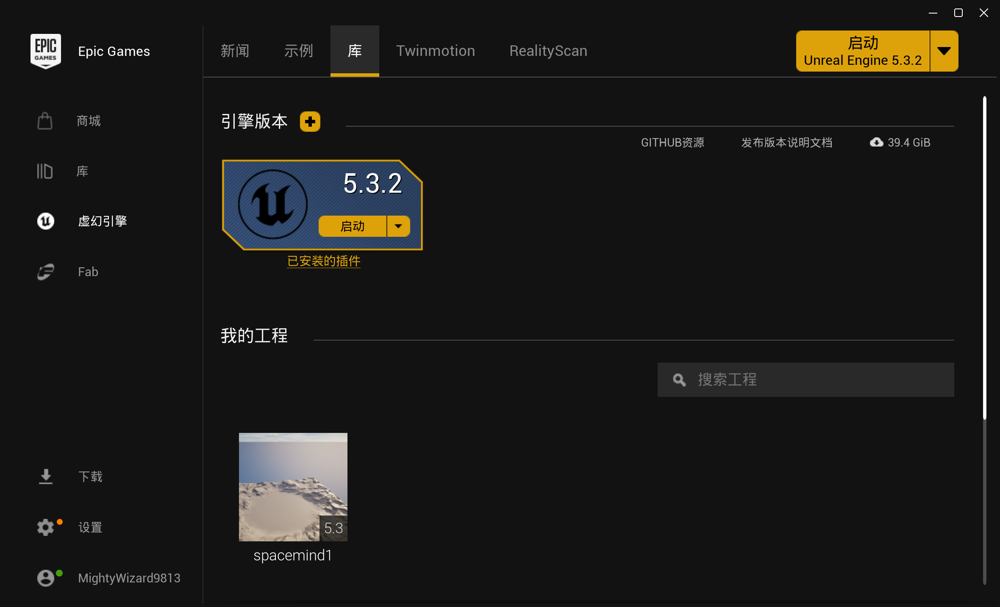
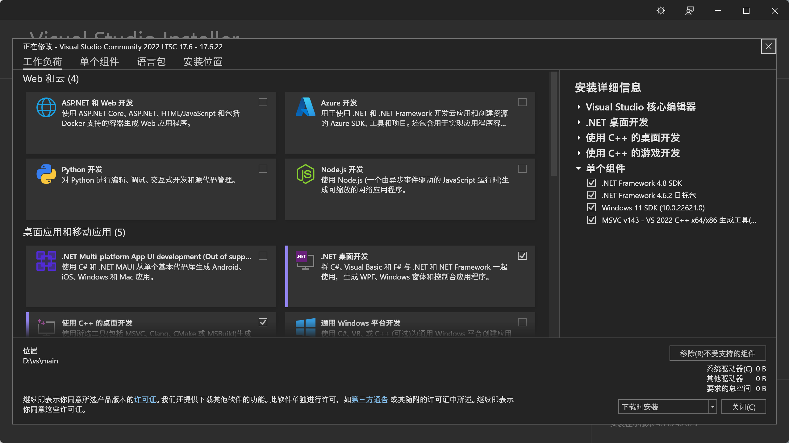
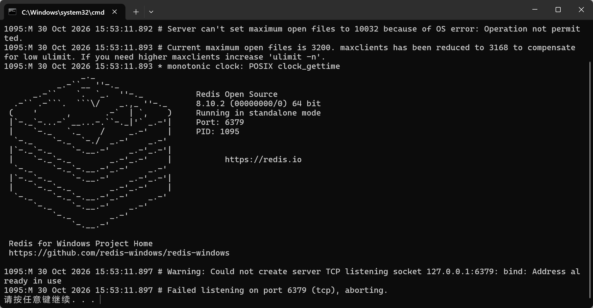
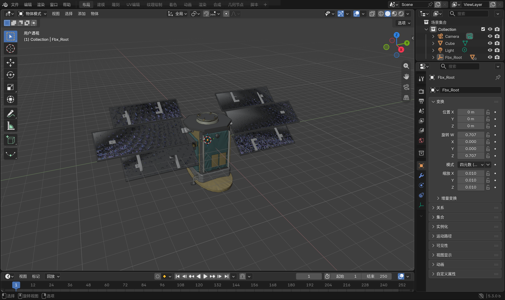
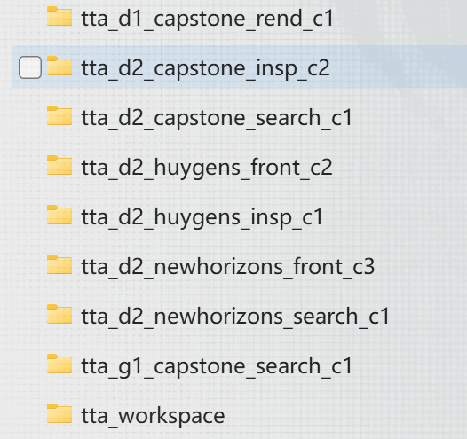
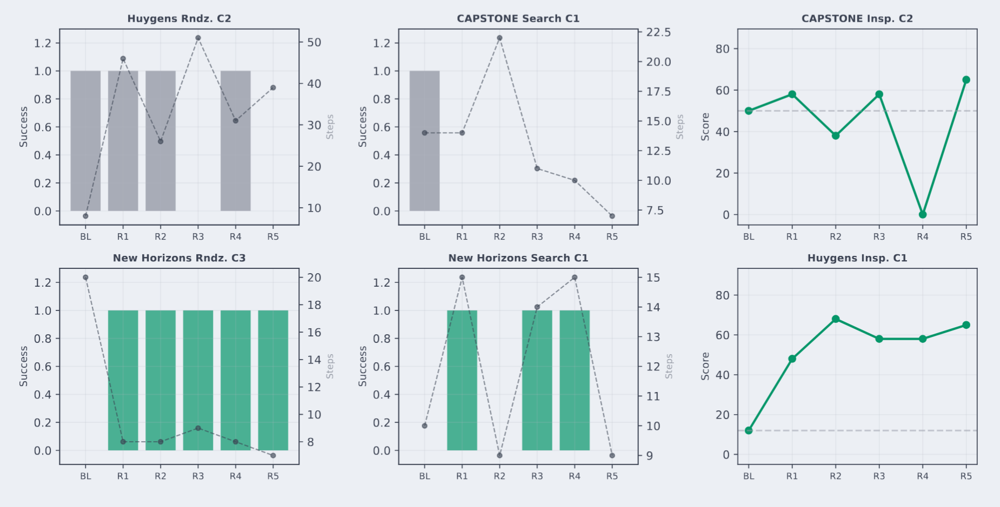
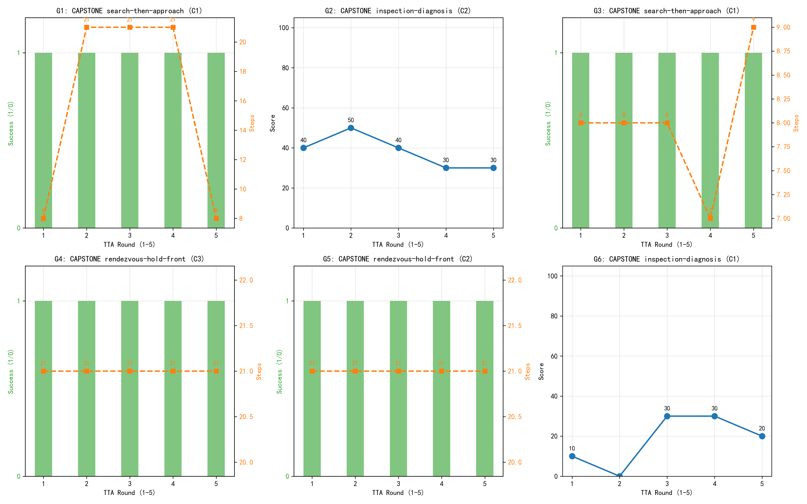

### 一、spacemind主要环境配置：

### UnrealEditor 5.3.2.0

顶级的实时3D创作工具，被广泛用于制作游戏，也深入到了影视、建筑等许多需要高保真视觉的领域

[虚幻引擎5 - Unreal Engine](https://www.unrealengine.com/unreal-engine-5?lang=zh-CN)




###  **VS 2022 LTSC 17.6**

​         底层对于UE5的文件编译存有MSVC 编译器，UE5 和 AirSim 官方并不会直接给一个现成的、能跑在 5.3 版本上的 `AirLib.lib`。必须用 VS 里的编译器，把从 GitHub 下载的 C++ 源码，硬生生地“编译”成 UE5 能识别的二进制文件。

[Visual Studio IDE - 用于编码调试和测试的 AI](https://visualstudio.microsoft.com/zh-hans/vs/)




### AIRSim分支Colosseum

 AirSim 主分支与 UE5.3 不兼容，必须拉取 `ue-5.3` 分支

git clone -b ue-5.3 --depth 1 --recursive https://github.com/CodexLabsLLC/Colosseum.git


### redis

Redis 是一个速度极快的内存数据库，它沟通了了“大模型”和“无人机”的数据传输

https://github.com/tporadowski/redis/releases 




### python环境3.12


### 模型来源：**NASA 3D Resources** 

[NASA-3D资源/3D模型/立方卫星 - ICECube at master ·NASA/NASA-3D资源](https://github.com/nasa/NASA-3D-Resources/tree/master/3D Models/CubeSat - ICECube)


###  **Blender**

​           对于外部导入的卫星格式修改，因为 UE5 默认只显示它支持的格式。需确保下载的是 **`.fbx`** 或 **`.glb`** 格式。如果是 `.stl`，就需要 3D 转换器转成 `.fbx`。



` **


##### 安全短语黑名单

解决大模型可能为了完成任务出现的危险操作

```
blocked_phrases = [
    "ignore safety", "disable safety", "skip safety",
    "ignore collision", "ignore overshoot",
    "skip final measurement", "always move blindly",
]
return any(phrase in merged for phrase in blocked_phrases)

```


##### 指纹去重

​        大模型反思生成的“新技能”里的核心要素决策类型、作用域、触发条件、规则、约束提取出来，打包成一个字典payload，然后转换成一个**格式化极度严格的 JSON 字符串**。主要减少冗余技能，缓解灾难性遗忘问题，比如去除前后空格，全部小写，sort_keys=True保证字典顺序

```
payload = {
    "decision_type": ..., "parent_skill": ...,
    "task_scope": ..., "run_mode_scope": ...,
    "trigger_condition": ...strip().lower(),
    "rule": ...strip().lower(),
    "constraints": ...strip().lower(),
}
return json.dumps(payload, ensure_ascii=False, sort_keys=True)
```


##### 任务范围绑定

1、生成阶段：强制打上“任务域”标签

​        大模型完成一轮实验，开始反思生成新技能时，Prompt 会强制要求它按五段式模板输出。其中有一个关键字段就是 **task_scope**

2、质量门拦截：验证任务归属

​      系统判定当前运行的任务，如果生成的标签与其不符，则将其丢掉

3、物理隔离：独立的 **tta_workspace**工作区

​      跑不同的任务，都会启动一个全新的、独立的文件夹

4、动态路由：技能网关只加载匹配的技能

​      根据任务读取相应的技能库，过滤对应标签，注入当前任务所需要的技能


##### 父技能验证

​       大模型需要去修改或者删除重写某一技能时，需要先去查探是否存在这一技能，防止大模型在反思时“胡编乱造”，去修改、覆盖或删除一个根本不存在的技能文件，从而导致系统崩溃。

```
if decision_type in {"overlay", "rewrite"}:
    parent_skill = decision.get("parent_skill", "")
    if not parent_skill or parent_skill not in skill_runtime.skills:
        return {"decision_type": "no_change", "reason": "parent skill not found"}
if decision_type == "rewrite" and decision.get("target_skill") not in skill_runtime.skills:
    return {"decision_type": "no_change", "reason": "rewrite target skill not found"}
if decision_type == "disable":
    if not (self.learned_skills_dir / decision["target_skill"] / "SKILL.md").exists():
        return {"decision_type": "no_change", "reason": "disable target not found"}
```


### 三、自进化TTA 

**Test-Time Adaptation**：测试时自适应

​        让大模型能够在实战过程中通过**收集失败经验从而生成技能附录**，而无需去训练大模型权重。极大程度上解决环境差异对于同一任务实现的影响；并且无需重新训练减少训练成本；

**训练过程**：数据收集——大模型复盘——提炼生成技能——注入下一轮


**黑匣子**：主要保存summary字典存储任务配置；执行结果评估；技能与知识；资源消耗。

再将信息送入大模型，模型需进行细粒度归因：是“底层执行偏差（如物理限速截断）”还是“高层策略失误”。

模型决定执行 `create`（新建）、`overlay`（叠加附录）、`rewrite`（重写）或 `disable`（禁用）操作。

经过质量门，生成合适的Markdown 文件扔进 `tta_workspace` 的技能库



学习技能文件构成：

#### Evidence

```
The episode shows repeated attempts to approach the target with fixed step sizes, leading to a failure mode of 'surface_distance_out_of_range'. This suggests a need for more precise step size adjustment near the final stopping point.
```

#### Rule——基于比例的动态步长
```
Calculate the forward step size as a percentage of the current distance, adjusting the percentage based on proximity to the target. Use a larger percentage (e.g., 20%) when far away and reduce it (e.g., to 10% or less) as the target distance decreases to ensure precision near the final stopping point. Additionally, ensure that the step size is recalculated after each move to reflect the updated distance and that the step size is reduced as the target distance decreases to avoid overshooting the final stopping point. If the target distance is below 3 meters, use a step size of 10% or less of the current distance to ensure precision.

version: 4

source: overlay
```

**动态路由**：

`SkillGateway` 在每轮开始时，根据任务描述和当前环境状态，从基础技能库和 learned_skills 库中进行筛选。

**按需注入**：

只提取匹配当前 `Task_Scope` 且 `Trigger` 条件满足的 Top-K通常为 1-2 个技能。这极大减轻了 7B 小模型的上下文负担，防止了“注意力稀释”问题。


将**active_skills**原始技能以及**learned_skills**额外生成技能送入大模型提示，模型成功率会大大上升。


#### 原TTA实验分析：



**新视野搜索C1和C3**，在自我进化后分别达到60%和100%的成功率。在新视野区域C3中，步数在五轮中从20稳定收敛到7，表明自动生成的学习技能编码了一种有效的距离相关步长减少策略。


**检查**任务，两组都通过叠加变异机制表现出一致收益：CAPSTONE Insp. C2 从 50 提升至 65 分，

Huygens Insp. C1 从 12 提升至平均 59.4 分。感知策略的增量叠加优化对此任务类型特别有效。


**CAPSTONE 搜索 C1 和惠更斯圆形区域 C2**，并不能从自我进化中获益，这表明该机制的主要价值在于**错误纠正和策略发现**，而非优化已经成功的行为。在所有组别中，标准技能文件格式中生成了七个学习技能，并在后续轮次中由技能网关正确路由，这证实了自我进化机制与模块化架构之间的兼容性。



## **实验过程中存在问题**

### **1、上下文超限**：

首轮生成的信息量过大，文本超过设置上下文限制，导致复盘失败。

解决方案：`build_episode_summary` 里，不要传所有步。只传**关键步**比如距离发生急剧变化的步，或者被物理限速拦截的步


