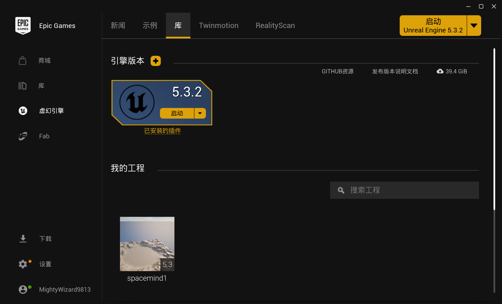
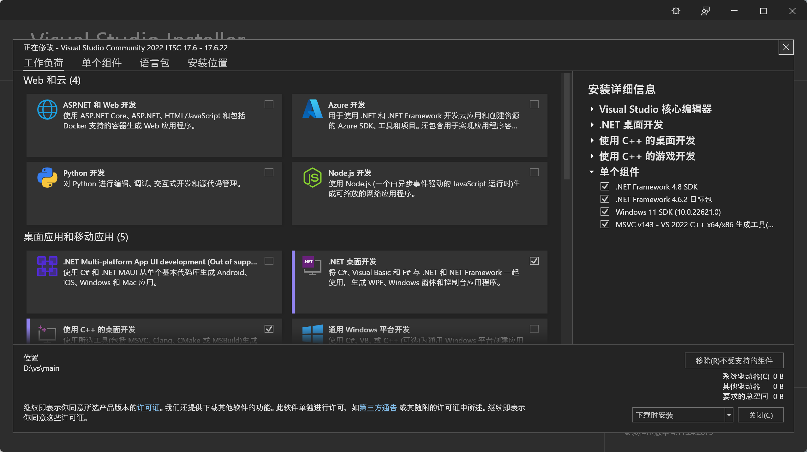
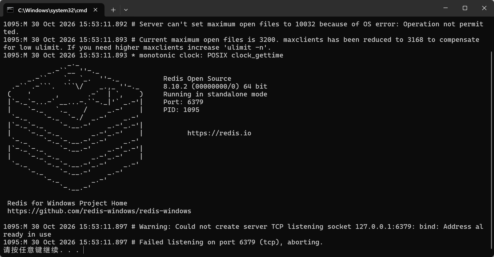
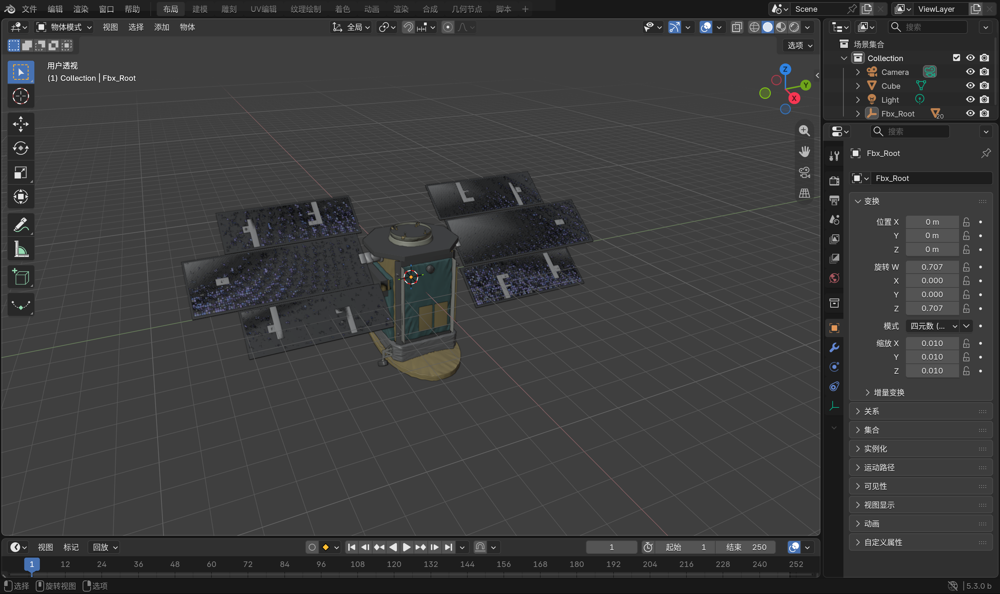
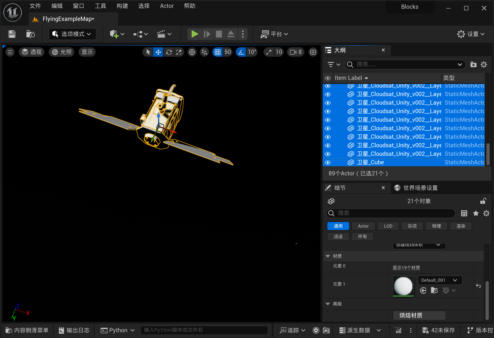
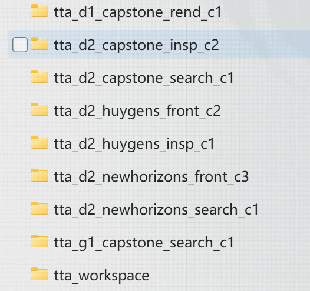
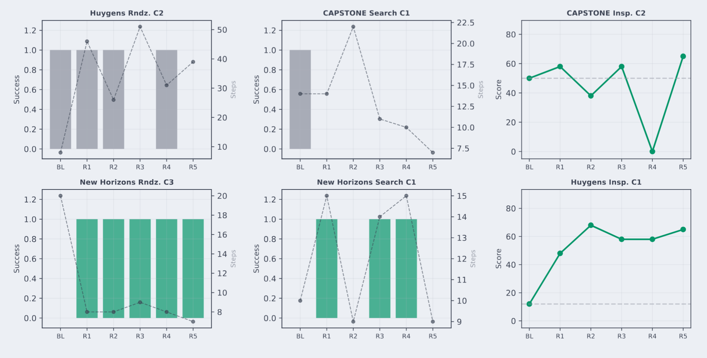
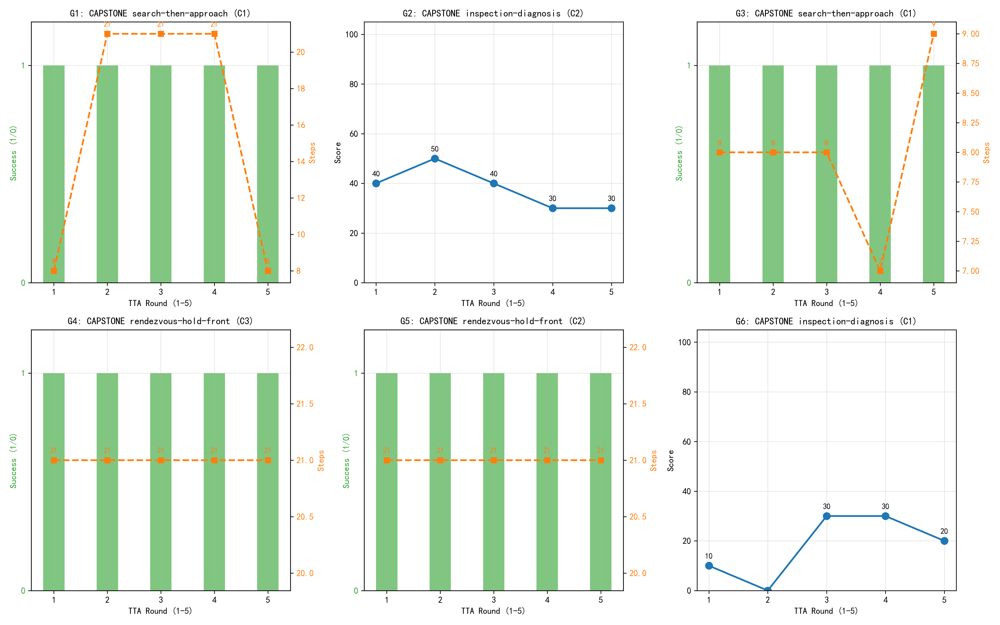
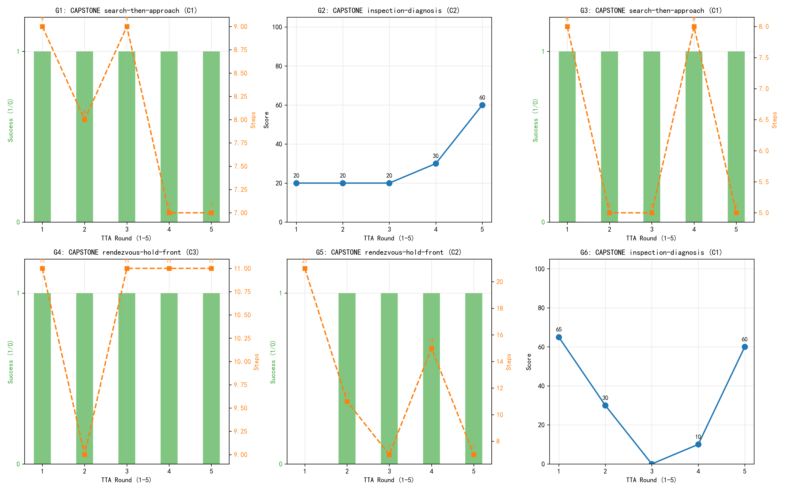
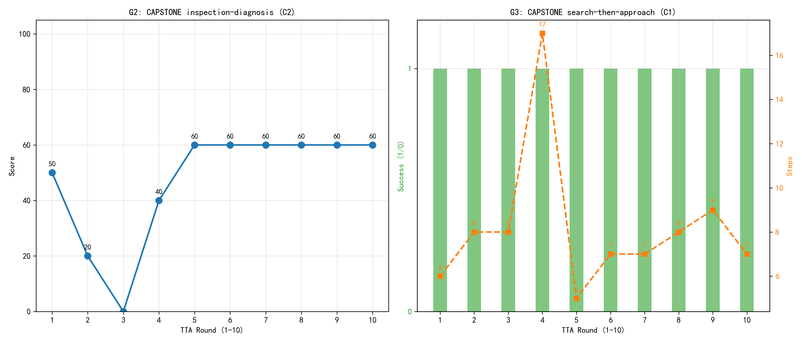

### 一、spacemind主要环境配置：

### UnrealEditor 5.3.2.0

顶级的实时3D创作工具，被广泛用于制作游戏，也深入到了影视、建筑等许多需要高保真视觉的领域

[虚幻引擎5 - Unreal Engine](https://www.unrealengine.com/unreal-engine-5?lang=zh-CN)




###  **VS 2022 LTSC 17.6**

​         底层对于UE5的文件编译存有MSVC 编译器，UE5 和 AirSim 官方并不会直接给一个现成的、能跑在 5.3 版本上的 `AirLib.lib`。必须用 VS 里的编译器，把从 GitHub 下载的 C++ 源码，硬生生地“编译”成 UE5 能识别的二进制文件。

[Visual Studio IDE - 用于编码调试和测试的 AI](https://visualstudio.microsoft.com/zh-hans/vs/)




### AIRSim分支Colosseum

 AirSim 主分支与 UE5.3 不兼容，必须拉取 `ue-5.3` 分支

git clone -b ue-5.3 --depth 1 --recursive https://github.com/CodexLabsLLC/Colosseum.git


### redis

Redis 是一个速度极快的内存数据库，它沟通了了“大模型”和“无人机”的数据传输

https://github.com/tporadowski/redis/releases 




### python环境3.12


### 模型来源：**NASA 3D Resources** 

[NASA-3D资源/3D模型/立方卫星 - ICECube at master ·NASA/NASA-3D资源](https://github.com/nasa/NASA-3D-Resources/tree/master/3D Models/CubeSat - ICECube)


###  **Blender**

​           对于外部导入的卫星格式修改，因为 UE5 默认只显示它支持的格式。需确保下载的是 **`.fbx`** 或 **`.glb`** 格式。如果是 `.stl`，就需要 3D 转换器转成 `.fbx`。





### 二、实验主要部件：

实验中返回是**RGB图像**以及**LIDAR距离**摘要组成


### **分层内存系统**：

##### 短期记忆➕长期记忆

​        短期记忆将图像，调用工具，结果等打包，等到步数超出设定限制，便将最开始的压缩为长期记忆，压缩为**自然语言**或者**强行截断长文本**（速度快，不产生幻觉，0 token消耗会丢失一些细节）之后共同送入大模型


### **MCP工具层——tools**

**MCP Server**

**感知**，`image_bright`, `part_segmentation`, `image_crop`, `image_zoom`

**测距**，lidar_info

**控制**，`set_position`, `set_attitude`, `set_exposure`, `terminate_navigation`

**知识**，knowledge_base

**辅助**，execute_code


### redis通信层

##### `tools/redis_contract.py` + `environments/satellite_pipeline/`

tools/redis_contract.py定义照片存储，飞行规则

信息传递的代码**fly_redis.py**，即去驱动ue5环境下飞行器的移动


### 质量门

reasoning/tta_manager.py文件中**`reflect_and_apply()` **

##### 安全短语黑名单

解决大模型可能为了完成任务出现的危险操作

```
blocked_phrases = [
    "ignore safety", "disable safety", "skip safety",
    "ignore collision", "ignore overshoot",
    "skip final measurement", "always move blindly",
]
return any(phrase in merged for phrase in blocked_phrases)

```


##### 指纹去重

​        大模型反思生成的“新技能”里的核心要素决策类型、作用域、触发条件、规则、约束提取出来，打包成一个字典payload，然后转换成一个**格式化极度严格的 JSON 字符串**。主要减少冗余技能，缓解灾难性遗忘问题，比如去除前后空格，全部小写，sort_keys=True保证字典顺序

```
payload = {
    "decision_type": ..., "parent_skill": ...,
    "task_scope": ..., "run_mode_scope": ...,
    "trigger_condition": ...strip().lower(),
    "rule": ...strip().lower(),
    "constraints": ...strip().lower(),
}
return json.dumps(payload, ensure_ascii=False, sort_keys=True)
```


##### 任务范围绑定

1、生成阶段：强制打上“任务域”标签

​        大模型完成一轮实验，开始反思生成新技能时，Prompt 会强制要求它按五段式模板输出。其中有一个关键字段就是 **task_scope**

2、质量门拦截：验证任务归属

​      系统判定当前运行的任务，如果生成的标签与其不符，则将其丢掉

3、物理隔离：独立的 **tta_workspace**工作区

​      跑不同的任务，都会启动一个全新的、独立的文件夹

4、动态路由：技能网关只加载匹配的技能

​      根据任务读取相应的技能库，过滤对应标签，注入当前任务所需要的技能


##### 父技能验证

​       大模型需要去修改或者删除重写某一技能时，需要先去查探是否存在这一技能，防止大模型在反思时“胡编乱造”，去修改、覆盖或删除一个根本不存在的技能文件，从而导致系统崩溃。

```
if decision_type in {"overlay", "rewrite"}:
    parent_skill = decision.get("parent_skill", "")
    if not parent_skill or parent_skill not in skill_runtime.skills:
        return {"decision_type": "no_change", "reason": "parent skill not found"}
if decision_type == "rewrite" and decision.get("target_skill") not in skill_runtime.skills:
    return {"decision_type": "no_change", "reason": "rewrite target skill not found"}
if decision_type == "disable":
    if not (self.learned_skills_dir / decision["target_skill"] / "SKILL.md").exists():
        return {"decision_type": "no_change", "reason": "disable target not found"}
```


##### 五段式技能

将大模型输出结构化，防止其大量输出撑爆经验库，并且可解释化，标准化。

```
body_lines = [
    "# Intent",       intent.strip(),       "",   # 意图
    "# Trigger",      trigger_condition.strip(), "",   # 触发器
    "# Rule",         rule.strip(),         "",   # 规则
    "# Constraints",  constraints.strip(),  "",   # 约束
    "# Evidence",     evidence.strip(),     "",   # 证据
]
```


### 三、自进化TTA 

**Test-Time Adaptation**：测试时自适应

​        让大模型能够在实战过程中通过**收集失败经验从而生成技能附录**，而无需去训练大模型权重。极大程度上解决环境差异对于同一任务实现的影响；并且无需重新训练减少训练成本；

**训练过程**：数据收集——大模型复盘——提炼生成技能——注入下一轮


**黑匣子**：主要保存summary字典存储任务配置；执行结果评估；技能与知识；资源消耗。

再将信息送入大模型，模型需进行细粒度归因：是“底层执行偏差（如物理限速截断）”还是“高层策略失误”。

模型决定执行 `create`（新建）、`overlay`（叠加附录）、`rewrite`（重写）或 `disable`（禁用）操作。

经过质量门，生成合适的Markdown 文件扔进 `tta_workspace` 的技能库



学习技能文件构成：

#### Evidence

```
The episode shows repeated attempts to approach the target with fixed step sizes, leading to a failure mode of 'surface_distance_out_of_range'. This suggests a need for more precise step size adjustment near the final stopping point.
```

#### Rule——基于比例的动态步长
```
Calculate the forward step size as a percentage of the current distance, adjusting the percentage based on proximity to the target. Use a larger percentage (e.g., 20%) when far away and reduce it (e.g., to 10% or less) as the target distance decreases to ensure precision near the final stopping point. Additionally, ensure that the step size is recalculated after each move to reflect the updated distance and that the step size is reduced as the target distance decreases to avoid overshooting the final stopping point. If the target distance is below 3 meters, use a step size of 10% or less of the current distance to ensure precision.

version: 4

source: overlay
```

**动态路由**：

`SkillGateway` 在每轮开始时，根据任务描述和当前环境状态，从基础技能库和 learned_skills 库中进行筛选。

**按需注入**：

只提取匹配当前 `Task_Scope` 且 `Trigger` 条件满足的 Top-K通常为 1-2 个技能。这极大减轻了 7B 小模型的上下文负担，防止了“注意力稀释”问题。


将**active_skills**原始技能以及**learned_skills**额外生成技能送入大模型提示，模型成功率会大大上升。


#### 原TTA实验分析：



**新视野搜索C1和C3**，在自我进化后分别达到60%和100%的成功率。在新视野区域C3中，步数在五轮中从20稳定收敛到7，表明**自动生成的学习技能编码了一种有效的距离相关步长减少策略**。


**检查**任务，两组都通过叠加变异机制表现出一致收益：CAPSTONE Insp. C2 从 50 提升至 65 分，

Huygens Insp. C1 从 12 提升至平均 59.4 分。感知策略的增量叠加优化对此任务类型特别有效。


**CAPSTONE 搜索 C1 和惠更斯圆形区域 C2**，并不能从自我进化中获益，这表明该机制的主要价值在于**错误纠正和策略发现**，而非优化已经成功的行为。在所有组别中，标准技能文件格式中生成了七个学习技能，并在后续轮次中由技能网关正确路由，这证实了自我进化机制与模块化架构之间的兼容性。


### 首轮实验数据：



对于G1,G4,G5的策略改善看不出效果，确实符合原实验证明的TTA只对于纠正误差有较大影响，对于成功的影响较小。其次，G2,G3分数略微下降以及略微上升。

## **实验过程中存在问题**

### **1、上下文超限**：

首轮生成的信息量过大，文本超过设置上下文限制，导致复盘失败。 TTA完全失效

解决方案：`build_episode_summary` 里，不要传所有步。只传**关键步**比如距离发生急剧变化的步，或者被物理限速拦截的步


### **2、过拟合**：

模型在复盘时，可能对于失败归因得出极端结论，比如看到了“因为走得太慢导致超时”的惩罚，于是得出了“下次必须迈大步”。

解决方案：在复盘 Prompt 里加上提示，比如失败是由于底层物理约束造成，那么便提示这约束条件。


### **3、物理层次限制**：

无法将任务全然交予大模型进行处理，由于大模型自回归生成，会存在注意力偏移造成影响。作为LLM，执行连续物理控制时，本质是**离散的、有幻觉**。

大模型输出指令收到防过冲指令限制，从而更加急迫输出更大的动作去打破限制。

解决方案：

从embodiskill中可知，传统的反思机制只要看到任务失败，就会去改技能；但 EmbodiSkill 认为，失败可能是“技能写错了”，也可能是“技能是对的，但 Agent 没执行好”，所以反馈轨迹分类。

当出现移动距离和输出数值差异时，确定是由于底层约束造成还是其他外部条件造成，告诉模型原因，Prompt 里直接提示它的行为是受到限制的。

##### 动作离散化：

**根据无人机的物理极限和视觉特性“硬编码”设定的。**

- **2.0m (LARGE)**：无人机视角相机在距离目标 10m 以上时，视野很广。2米前进不会导致目标飞出视野，且能快速推进。
- **1.0m (MEDIUM)**：距离 5m-10m 时的稳妥步长。
- **0.3m (SMALL)**：距离 2m-5m 时的微调步长。因为一旦太近，相机画面里全是卫星表面，失去了全局视野，必须小步走。
- **0.0m (HOVER)**：原地悬停。

##### 问题一：**为什么要多此一举，不让模型直接输出 `2.0`、`0.5`等连续数值？**

**因为 7B 级别的小模型，对“连续数值”的回归能力极差。**
如果你让它自己算，它可能会输出 `dx=3.5`，或者 `dx=0.0001`，又或者输出 `dx=1.234567` 这种无意义的数字。
让它输出离散的文字标签（大、中、小），其实是在利用大模型极强的“语义理解能力”，绕过它极弱的“数学计算能力”。 “大模型负责意图，小模型/代码负责数值”。

**问题二：如果TTA进化产生的距离-步长规则和底层物理限制冲突怎么办？**

首先明确，如果不需要底层物理限制，通过训练自进化确实可以获得相应技能，但是对于训练次数有要求，前几轮或者十几轮全部在杂乱移动，学会的成本比较高。

其次，在底层物理限制下，若是自进化学习到技能，仍然可以在规则范围内实现，总之，底层物理限制是最后底线，严格保证安全，从而降低效率。

**路线 A：保持硬约束，但允许 TTA 影响参数**
把 `_apply_physical_constraints` 里的阈值从“写死”改成“可配置”，并让 TTA 能输出这些参数。比如：

json

```
{
  "max_dx_at_2m": 0.2,
  "max_dx_at_3m": 0.5,
  "max_dx_at_5m": 2.0,
  "safety_margin": 1.0
}
```

TTA 学到的“更好规则”直接写进这个 JSON，执行层读这个 JSON 来限速。这样 TTA 的改进**真正生效**，而不是只停留在 Prompt 里。


### **4、历史经验库的“过度膨胀”**：

输入信息过多，注意力被稀释，不知道如何执行，灾难性遗忘问题

解法一：强制淘汰机制。在 读取技能时，不要全读。按照时间戳排序，最多只加载最新的 2到3个技能，旧的直接在代码层面忽略。

解法二：RAG 检索注入。把所有技能存在向量数据库里。根据当前环境以及阶段，检索最匹配的技能；只把当下最需要的 1~2 个技能塞进 Prompt。


**5、** **技能的“自相矛盾”**：

前几轮生成的技能相互冲突，比如要求大距离移动和小距离移动的对抗

解决方案就是覆盖更新。在 TTA 复盘时，强制要求模型：如果新技能和旧技能冲突，必须指明用新内容覆盖旧文件，而不是无限新增文件。


**6、大模型的“自回归幻觉”**    防幻觉终止

模型本身原由，可能存在输出错误。

**约束解码**。vLLM 原生支持 `guided_decoding_backend="xgrammar"`。它并非等模型生成完整文本后再去解析或重试，而是在**每一个 token 的生成瞬间**，就通过一个“格式掩码”强行屏蔽掉所有不符合预设格式的 token，解决格式不合规。

**强制目标对齐**：，以通过正则约束，强制规定：如果距离大于安全阈值，大模型调用停止工具想要结束实验，就通过捕获的距离不合规去阻止，并且让它旋转，或者强制位移继续输出动作。直接从解码层物理掐断幻觉，解决数据不合规。




| 轮次 | 步数 | 轨迹（大致）                  | 关键事件                                                     |
| :--- | :--- | :---------------------------- | :----------------------------------------------------------- |
| R1   | 9    | 1.0×5 → 0.5×2                 | 无技能，纯 baseline，保守稳定                                |
| R2   | 6    | 1.0×5 → 0.5×2                 | 触发一次自我纠正，兜底强制 0.5                               |
| R3   | 9    | 1.0×2 → 2.0×1 → 1.0×1 → 0.5×2 | 模型保守稳定，步数加长，触发了防幻觉终止，**TTA 生成 `distance-strategy-learned`** |
| R4   | 7    | 2.0×2 → 1.0×1 → 0.5×1 → 0.3×3 | 第一次注入技能，学会了“大步”                                 |
| R5   | 7    | 1.0×2 → 2.0×1 → 1.0×1 → 0.5×2 | 技能继续生效                                                 |

**结论**： TTA 不是“学完就固化”，而是“解锁了一个能力，但模型不一定每次都用”。G3实验**8 步和 5 步交替出现，就是 7B 模型在“大胆用大步”和“退回保守”之间反复横跳**。


通过实验，能看见spacemind存在的痛点，它对于轨迹反馈以及额外的技能更新比较粗粝。当任务失败后，它可能会生成相互冲突的指令，或者是写废话。

在embodiskills，中能够学习到，它是将技能分为正文以及附录，将结果分为成功发现优化，失败缺陷失误。如果将其应用到spacemind任务执行，是否对于其执行技能更新更好。

| 对比维度     | SpaceMind (技能自进化)                   | EmbodiSkill (技能感知反思)                               |
| :----------- | :--------------------------------------- | :------------------------------------------------------- |
| **反思触发** | 每个 Episode 结束后直接更新              | 轨迹攒在 Buffer 里，积攒够了统一合并去重                 |
| **归因逻辑** | 只看结果好坏，进行**粗粒度**的文件级变异 | 区分“技能真错”和“模型没照做”，进行**细粒度**的结构化修改 |
| **修改位置** | 直接增删改查整个 `SKILL.md` 文件         | 严格隔离：修改 `Body` 还是只加 `Appendix` 警告           |

但是技能感知反思是每一轮都存在，但是修改技能是等到攒够一定量才开始，那么训练量会增大。

实验10轮刚好执行三次的统一更新，以及一次的验证。

TTA➕技能感知反思缓冲实验结果如下，



存在问题，由于加入了缓冲，造成上下文超限token爆炸；时间很慢。而且效果并不明显。


### 四、**那shaper呢？**

shaper：冻结大模型，只更新技能与上下文代码

##### 1、可编程上下文

spacemind给大模型的轨迹步数固定，比如保留最近 5 步塞入上下文。

**SHAPER ： **Harness上下文代码。Harness 是一个 Python 函数 `build_context(history)`，它决定了在特定的轨迹上，应该给大模型看哪几张图、哪几句思考、哪几个状态。


##### 2、两阶段束搜索

原始它可能因为一次偶然的幻觉，写下了一条错误的技能，直接导致后面的轮次全盘崩溃。

Top-K 束搜索：不让大模型直接生成技能，而是候选三个技能让大模型候选


​        但是实际落地比较困难，其一，这两个改进方面对于模型的要求比较高，所用的qwen2.5-vl-7b模型难以维继，可编程上下文需要额外的沙盒验证，保证生成的代码有效且安全，两阶段搜索，预测动作的验证都需要在ue5中实现造成资源浪费。


**3、分层裁判**

每一步，每一轮都需要大模型去裁决轨迹的好坏，这对于模型压力确实比较大，所以可以考虑将大模型裁判降维成代码规则裁判，不需要额外调用大模型。在 SpaceMind 现有的框架里，底层的很多信号已经告诉我们“这一步好不好”了，我们只需要在代码里加个 `tag` 即可。

这就区分了传统方法如 LLM-as-a-Judge用大模型去打分，缓解了二次幻觉的引入，在 TTA 复盘时，我们不再输入冗长的文本轨迹，而是输入这些高度压缩的**‘元事件标签’**。

##### 在 host.py 中
def _record_episode_step(self, step_index: int, image_data: dict, result: dict):
    
    if result.get("physical_limited"):
        step_tag = "EXECUTION_LAPSE_PHYSICAL_LIMIT"  # 物理限速
    elif result.get("terminate_navigation") and current_dist > 3.0:
        step_tag = "SKILL_DEFECT_PREMATURE_TERMINATE" # 过早终止
    elif result.get("tool_name") == "set_position" and abs(result["position_change"].get("dx", 0)) < 0.1:
        step_tag = "STAGNATION" # 原地发呆
    else:
        step_tag = "NORMAL"
        
    self.episode_steps.append({
        # ... 原有字段 ...
        "step_tag": step_tag  # 存入标签
    })

当飞行结束，在进入 TTA 反思时，我们只在总结里传入这 20 步里的 `tag` 组合，而不是全部文本。


1. **零算力消耗**：完全是纯 Python 的字符串匹配，瞬间完成，节省token
2. **直击痛点**：送给 7B 模型的反思文本字数减少，极大地减轻了模型处理长文本的压力。模型能精准地知道：‘我是因为被物理拦截而超时，而不是因为我的策略错’。”
3. **分层**：把 20 步的原始长文本，**分层压缩**成了几个关键事件。


### 五、模型修改处：

缩短了最大步数：`MAX_EPISODE_STEPS` 从 50 降到了 20。

缩减了图像分辨率：`MAX_IMAGE_DIM` 从 640 降到了 448，提高推理速度。

缓解了大模型压力，不用输出全部，而是提供固定模板，直接填空。

安全机制：

修复了发呆时的死循环：原始版在发呆时发的是 `set_position(dx=0, dy=0, dz=0)`，这会导致模型永远卡在原地。优化版改成了 `set_attitude(dyaw=15.0)`，强制原地转圈寻找目标。

物理限速：`_apply_physical_constraints` 根据当前 LiDAR 距离动态截断 `dx`，防止小质量航天器撞目标。

防幻觉终止：距离 >2m 时 `terminate_navigation` 被拒，改为继续靠近。

被动工具上限：连续 ≥3 次只做感知（分割/裁剪）→ 强制转向。

黄金区自动悬停：进入 1.8–2.5m 自动结束并打分，避免模型"想停又不敢停"。


实验模型由单模型换成双模型，即一个模型训练，一个模型打分，解决打分作弊偏爱问题

后续可实现消融实验。


